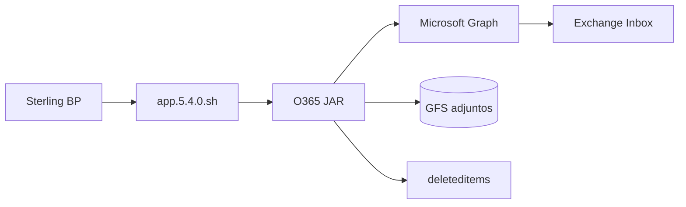

# O365InboxAttachmentToDisk — Microsoft Graph + Sterling GFS

Aplicación Java (CLI) que lee el buzón vía **Microsoft Graph**, descarga adjuntos (`dominio/remitente/archivo`) y mueve mensajes a una carpeta **well-known** (por defecto **Elementos eliminados** / `deleteditems`).

**Versión actual del JAR:** ver `pom.xml` (ej. `5.4.3`).

---

## Documentación (índice)

| Prioridad | Enlace |
|-----------|--------|
| **Índice completo** | [docs/README.md](docs/README.md) |
| **Backlog / orden trabajo** | [docs/implementacion/00-BACKLOG-y-orden-implementacion.md](docs/implementacion/00-BACKLOG-y-orden-implementacion.md) |
| **Manual operativo** | [docs/implementacion/MANUAL-O365-GRAPH.md](docs/implementacion/MANUAL-O365-GRAPH.md) |
| **Entregable GFS** | [artifact/README.md](artifact/README.md) |
| Memoria agente (Claude/Cursor) | [CLAUDE.md](CLAUDE.md) |
| Histórico v2.0 (processed → deleteditems) | [docs/HISTORICO-CAMBIOS.md](docs/HISTORICO-CAMBIOS.md) |
| Arquitectura (C4) | [docs/arquitectura/README.md](docs/arquitectura/README.md) |
| ADR / runbooks / rutas GFS | [docs/decisions/](docs/decisions/) · [docs/runbooks/](docs/runbooks/) · [docs/definiciones/](docs/definiciones/) |
| TechDocs (MkDocs) | [docs/index.md](docs/index.md) |

---

## Inicio rápido (desarrollo)

```bash
cp secrets.env.example secrets.env
source scripts/load-secrets.sh
./build.sh
mkdir -p ./tmp-attachments
export PROCESSED_FOLDER=deleteditems
java -jar target/O365InboxAttachmentToDisk-*.jar \
  -tenant "$TENANT_ID" -client "$CLIENT_ID" -secret "$CLIENT_SECRET" \
  -email "$MAIL_CORREO" -dir "./tmp-attachments/"
```

## Producción Sterling (GFS)

```bash
cd /gfssterling/jar
./app.5.4.0.sh "<MAIL_CORREO>" "<WFID>"
```

Detalle: manual §5 (cifrado), §7 (despliegue).

---

## Estructura del proyecto

```
sterling-msgraph-sdk-java/
├── CLAUDE.md · .cursorrules
├── .cursor/rules/msgraph-o365-project.mdc
├── .cursor/skills/o365-deploy-lab/
├── README.md · pom.xml · build.sh · run-tests.sh
├── secrets.env.example · secrets.env (no Git)
├── docs/
│   ├── README.md                # Índice maestro documentación
│   ├── index.md                 # Portada MkDocs
│   ├── HISTORICO-CAMBIOS.md · CHANGELOG.md
│   ├── decisions/               # ADR
│   ├── runbooks/                # Índice operativo
│   ├── definiciones/            # Rutas GFS, glosario
│   ├── arquitectura/            # Modelo C4 (01-contexto … 10-entornos-stack)
│   ├── design/ · build/ · support/
│   └── implementacion/          # Manual, backlog, uso, deploy
├── src/main/java/co/com/edtech/msgraph/  (+ CLAUDE.md)
├── artifact/                    # Entregable despliegue → GFS (ver artifact/README.md)
│   └── jar/                     # Paridad /gfssterling/jar/
├── scripts/ · postman/
└── .claude/skills/              # Paridad skills Claude Code
```

---

## Secretos

| Archivo | Git | Uso |
|---------|-----|-----|
| `secrets.env.example` | Sí | Plantilla |
| `secrets.env` | **No** | Azure, buzón, proxy, cert |

```bash
source scripts/load-secrets.sh
./scripts/sync-postman-env.sh   # opcional Postman
```

---

## Arquitectura (resumen)



Arquitectura C4: [docs/arquitectura/README.md](docs/arquitectura/README.md).

---

## Swagger / OpenAPI (Graph local)

```bash
./scripts/serve-swagger.sh
# http://127.0.0.1:8088/
```

Spec: `openapi/o365-sterling-graph.openapi.yaml` · Guía: `openapi/README.md`

## Tests

```bash
./run-tests.sh
mvn test
```

---

## Lab Sterling (referencia)

| Parámetro | Valor típico |
|-----------|----------------|
| Host | `192.168.137.190` |
| JAR | `/gfssterling/jar/5.0.0/O365InboxAttachmentToDisk-5.4.3.jar` |
| SSH WSL2 | `JASPER_SSH_BIN=/mnt/c/Windows/System32/OpenSSH/ssh.exe` |

---

## Stack

Java 17 · Microsoft Graph SDK · Azure Identity · Maven shade · CipherConsole (GFS)
