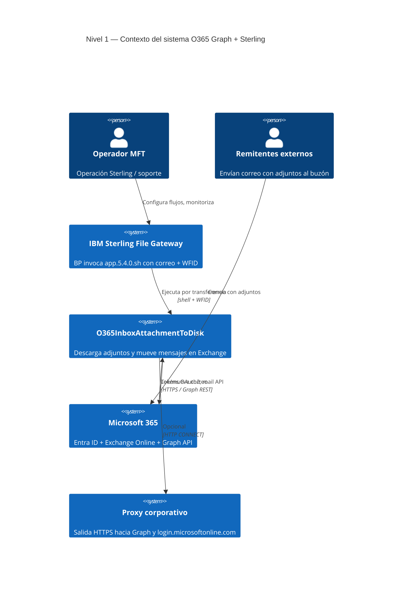
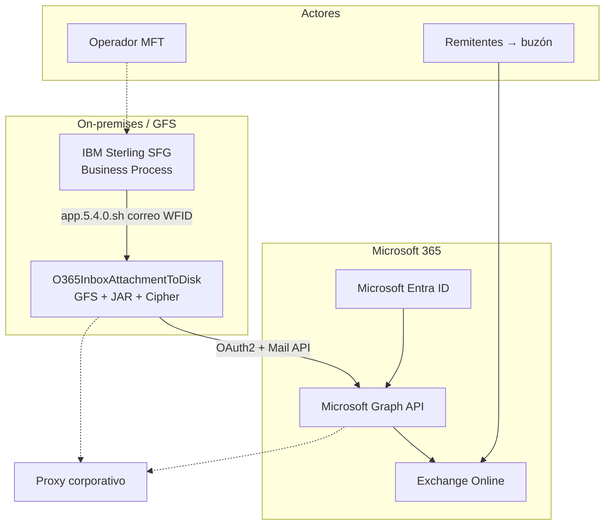

# C4 — Nivel 1: Diagrama de contexto

**Sistema en foco:** `O365InboxAttachmentToDisk` (solución on-prem en GFS).

**Audiencia:** negocio, arquitectura, operaciones MFT.

← [Índice C4](README.md) · Siguiente: [02-contenedores.md](02-contenedores.md)

---

## Diagrama

### Vista alternativa (flowchart)

Si el visor no renderiza `C4Context`:

---

## Elementos del contexto

| Elemento | Tipo C4 | Rol en el negocio | En este flujo |
|----------|---------|-------------------|---------------|
| Operador MFT | Persona | Configura Sterling y GFS | `mail_list`, `.enc`, despliegue JAR |
| Remitentes externos | Persona | Envían correo al buzón | Dejan adjuntos en **Inbox** |
| IBM Sterling SFG | Sistema | Orquestador MFT | BP → shell; consume `ListF.xml` |
| O365InboxAttachmentToDisk | **Sistema** (caja) | Solución batch | Todo entre invocación shell y XML |
| Microsoft 365 | Sistema externo | Identidad + correo + API | Entra, Graph, Exchange |
| Proxy corporativo | Sistema externo | Salida HTTPS | Opcional |

---

## Relaciones principales

| Desde | Hacia | Descripción |
|-------|-------|-------------|
| Sterling | O365InboxAttachmentToDisk | Ejecuta `app.5.4.0.sh` con correo + WFID |
| O365InboxAttachmentToDisk | Microsoft 365 | OAuth2 + REST Graph (mail, attachments, move) |
| Remitentes | Microsoft 365 | Correo entrante con adjuntos |
| Operador | Sterling | Configuración y monitoreo de flujos |

---

## Límites de responsabilidad

- Sterling **no** llama a Graph directamente.
- Microsoft **no** escribe en GFS.
- La solución **no** crea carpetas custom bajo Inbox (solo **well-known** — [ADR-001](../decisions/ADR-001-carpetas-well-known-only.md)).

---

## Referencias

- Contenedores: [02-contenedores.md](02-contenedores.md)
- Secuencia E2E: [06-dinamica-e2e.md](06-dinamica-e2e.md)
