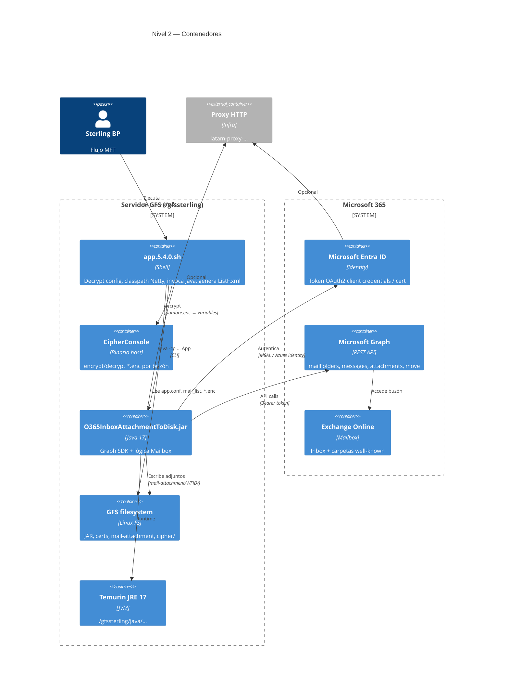

# C4 — Nivel 2: Diagrama de contenedores

Desglose del sistema **O365InboxAttachmentToDisk** en contenedores desplegables y servicios externos.

← [01-contexto.md](01-contexto.md) · [Índice](README.md) · [Entregable](../../artifact/README.md) · Siguiente: [03-componentes.md](03-componentes.md)

---

## Diagrama

---

## Catálogo de contenedores

| Contenedor | Tecnología | Responsabilidad |
|------------|------------|-----------------|
| **Sterling BP** | IBM Sterling SFG | Dispara `app.5.4.0.sh` (`MAIL_CORREO`, `WFID`) |
| **app.5.4.0.sh** | POSIX shell | `app.conf`, `mail_list`, decrypt, Java, `ListF.xml` |
| **CipherConsole** | Binario GFS | Cifrado config por buzón (`*.enc`) |
| **O365InboxAttachmentToDisk.jar** | Java 17 shaded | Graph + descarga + move |
| **GFS filesystem** | Linux | `/gfssterling/jar`, `/cipher`, certs |
| **Temurin JRE 17** | JVM | Runtime del JAR |
| **Microsoft Entra ID** | SaaS | App registration, secret o cert |
| **Microsoft Graph** | REST `v1.0` | Mail, attachments, move |
| **Exchange Online** | Buzón M365 | Inbox, deleteditems, etc. |
| **Proxy corporativo** | HTTP | Salida a Internet |

---

## Flujo entre contenedores

1. **BP → shell:** args `"<correo>" "<WFID>"`; exit code 0/1.
2. **Shell → Cipher:** `mail_list` → `<alias>.enc` → variables en memoria (`*_out` borrado).
3. **Shell → JAR:** `java -cp` JAR + Netty; `-certificate` (prod) o `-secret` (lab); `-dir` = `mail-attachment/<WFID>/`.
4. **JAR → Entra:** OAuth 2.0 client credentials (permiso de **aplicación**).
5. **JAR → Graph → Exchange:** Inbox con adjuntos → move well-known.
6. **JAR → GFS:** `dominio/usuario/archivo`.
7. **Shell → GFS:** `find` + **`ListF.xml`**.

**Fallos frecuentes:** decrypt Cipher; `Mail.ReadWrite` sin admin consent.

---

## Referencias

- Componentes del JAR: [03-componentes.md](03-componentes.md)
- Despliegue GFS: [05-despliegue.md](05-despliegue.md)
- Integraciones: [09-integraciones.md](09-integraciones.md)
