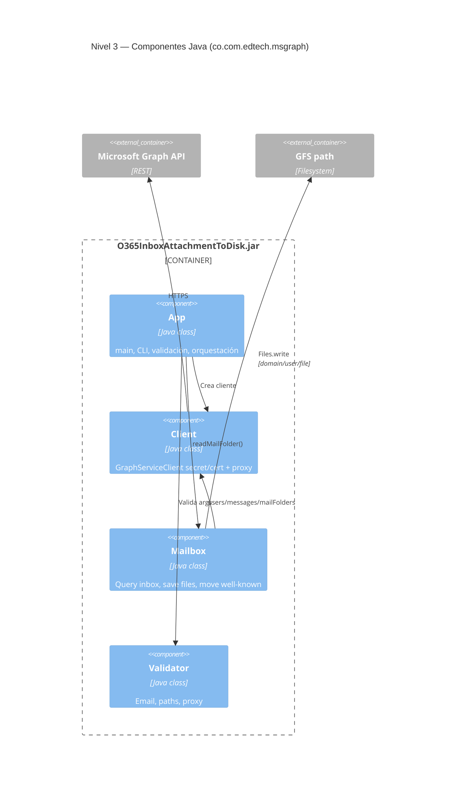

# C4 — Nivel 3: Diagrama de componentes

Componentes dentro del contenedor **O365InboxAttachmentToDisk.jar** (`co.com.edtech.msgraph`).

← [02-contenedores.md](02-contenedores.md) · [Índice](README.md) · Siguiente: [04-codigo.md](04-codigo.md)

---

## Diagrama



---

## Responsabilidades

| Componente | Entrada | Efecto |
|------------|---------|--------|
| **App** | CLI: `-tenant`, `-client`, `-secret` \| `-certificate`, `-email`, `-dir`, proxy | Orquesta validación, cliente Graph, `Mailbox` |
| **Validator** | Strings, paths | Email, path, proxy coherentes |
| **Client** | Credenciales + proxy | `GraphServiceClient`; scope `graph.microsoft.com/.default` |
| **Mailbox** | Client, inbox id, path, email | Query, save, move well-known |

---

## Llamadas Graph (Mailbox / Client)

| Operación | API (ejemplo) |
|-----------|----------------|
| Token | Entra vía `ClientSecretCredential` o `ClientCertificateCredential` |
| Listar | `GET .../mailFolders/inbox/messages?$filter=hasAttachments&$expand=attachments` |
| Carpeta destino | `GET .../mailFolders/{deleteditems}` |
| Mover | `POST .../messages/{id}/move` |

---

## Cadena runtime

```text
App.main
  → Validator
  → Client.getClientByCertificate(...) | getClientBySecret(...)
  → Mailbox.readMailFolder(client, "inbox", pathDestino, email)
       → getenv("PROCESSED_FOLDER") o "deleteditems"
       → por mensaje: saveAttachment → move
```

**Comportamiento:** fallo en move de un mensaje → log y continúa; sin reintentos ni cola.

**Config en Java:** solo `PROCESSED_FOLDER` por entorno (`deleteditems`, `sentitems`, `drafts`, `junkemail`).

---

## Referencias

- Código fuente: [04-codigo.md](04-codigo.md)
- Dinámica E2E: [06-dinamica-e2e.md](06-dinamica-e2e.md)
- Exchange: [07-dinamica-exchange.md](07-dinamica-exchange.md)
