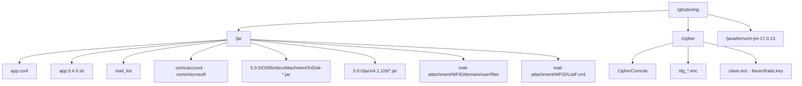

# C4 — Vista de despliegue

**Dónde** se ejecutan los contenedores (servidor GFS y servicios cloud).

← [Índice](README.md) · Entregable: [artifact/README.md](../../artifact/README.md) · Rutas: [ESTANDAR-RUTAS-GFS-O365.md](../definiciones/ESTANDAR-RUTAS-GFS-O365.md)

---

## Diagrama de despliegue (GFS)

---

## Nodos

| Nodo | Rol |
|------|-----|
| **Servidor GFS** (lab `192.168.137.190`) | Host único on-prem: shell, JAR, Cipher, salida |
| **Microsoft 365** | Entra + Graph + Exchange (SaaS) |
| **Estación desarrollo** | Build Maven, `secrets.env`, pruebas locales |
| **Proxy corporativo** | Opcional en ruta salida |

---

## Rutas y contenedores

| Ruta GFS | Contenedor / artefacto |
|----------|-------------------------|
| `/gfssterling/jar/app.conf` | Config shell |
| `/gfssterling/jar/app.5.4.0.sh` | Shell |
| `/gfssterling/jar/mail_list` | Mapa buzón → cipher |
| `/gfssterling/jar/5.0.0/*.jar` | JAR + Netty |
| `/gfssterling/jar/certs/` | Certificados canónicos (`account/`, `microsoft/`) — [README](../../artifact/jar/certs/README.md) |
| `/gfssterling/cipher/` | CipherConsole, `.enc` |
| `/gfssterling/jar/mail-attachment/<WFID>/` | Salida batch |
| `/gfssterling/java/...` | JRE 17 |

---

## Referencias

- Manual despliegue: [implementacion/MANUAL-O365-GRAPH.md](../implementacion/MANUAL-O365-GRAPH.md) §7
- Contenedores: [02-contenedores.md](02-contenedores.md)
