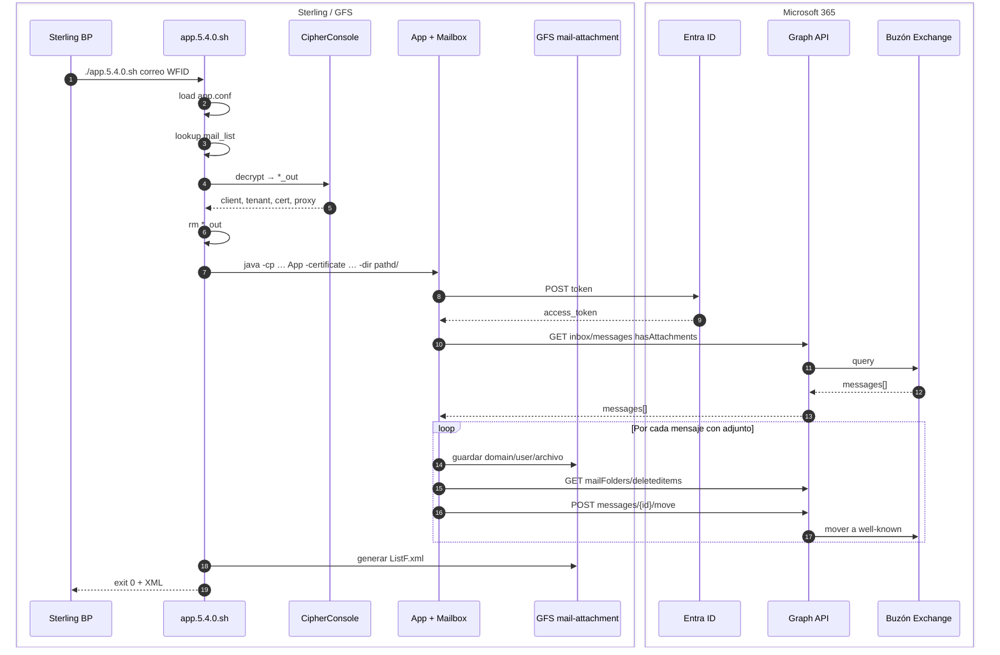

# C4 — Vista dinámica: flujo E2E

**Cuándo** ocurre cada interacción entre contenedores (Sterling → Graph → GFS).

← [Índice](README.md) · Contexto: [01-contexto.md](01-contexto.md)

---

## Diagrama de secuencia

---

## Paso a paso

| # | Quién | Acción |
|---|--------|--------|
| 1 | Sterling BP | `./app.5.4.0.sh "<correo>" "<WFID>"` |
| 2 | Shell | Lee `app.conf` |
| 3 | Shell | Resuelve buzón en `mail_list` |
| 4 | CipherConsole | Decrypt `<alias>.enc` |
| 5 | Shell | Borra `*_out`; arma classpath |
| 6 | JAR / Client | Token OAuth2 |
| 7 | JAR / Mailbox | GET Inbox con adjuntos |
| 8 | JAR / Mailbox | Escribe ficheros en GFS |
| 9 | JAR / Mailbox | Move a well-known |
| 10 | Shell | Genera `ListF.xml` |
| 11 | Sterling BP | Continúa flujo MFT |

---

## Resultados esperados

- **Exchange:** mensajes fuera de Inbox (default **deleteditems**).
- **GFS:** `mail-attachment/<WFID>/` + `ListF.xml`.

Histórico carpeta `processed`: [HISTORICO-CAMBIOS.md](../HISTORICO-CAMBIOS.md).

---

## Referencias

- Estados correo: [07-dinamica-exchange.md](07-dinamica-exchange.md)
- Componentes: [03-componentes.md](03-componentes.md)
