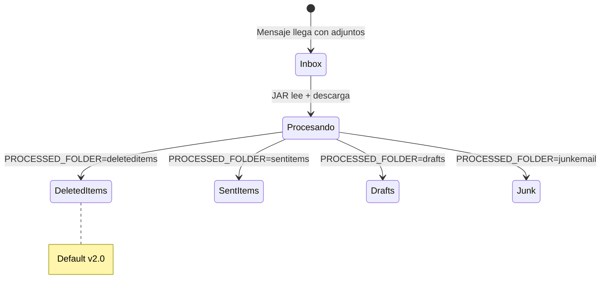

# C4 — Vista dinámica: dominio Exchange

Comportamiento del **buzón** durante el batch (reglas de negocio en `Mailbox.java`).

← [Índice](README.md) · ADR: [ADR-001](../decisions/ADR-001-carpetas-well-known-only.md)

---

## Diagrama de estados

---

## Reglas

1. Solo **Inbox** con `hasAttachments eq true`.
2. Tras procesar: **move** a carpeta **well-known** existente.
3. `PROCESSED_FOLDER` por entorno; default **`deleteditems`**.
4. Valores válidos: `deleteditems`, `sentitems`, `drafts`, `junkemail`.
5. **No** `createChildFolder` ni `Inbox/processed`.

---

## Configuración

Ver [DELETED_ITEMS_CONFIGURATION.md](../DELETED_ITEMS_CONFIGURATION.md) y manual §8.

---

## Referencias

- Secuencia E2E: [06-dinamica-e2e.md](06-dinamica-e2e.md)
- Componente Mailbox: [03-componentes.md](03-componentes.md)
