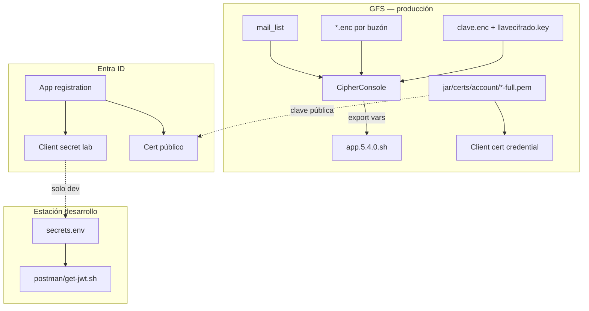

# C4 — Vista: seguridad y datos sensibles

Flujo de credenciales (desarrollo vs producción GFS).

← [Índice](README.md) · Manual Cipher: [MANUAL-O365-GRAPH.md](../implementacion/MANUAL-O365-GRAPH.md) §5

---

## Diagrama

---

## Artefactos

| Artefacto | Ubicación | Uso |
|-----------|-----------|-----|
| `secrets.env` | Repo local (gitignore) | Dev, Postman |
| `mail_list` | `/gfssterling/jar/` | Correo → alias cipher |
| `<alias>.enc` | `/gfssterling/cipher/` | Config cifrada |
| `*-full.pem` | `/gfssterling/jar/certs/account/` (repo: `artifact/jar/certs/account/`) | Auth cert Graph |
| CAs | `.../certs/microsoft/` | Referencia TLS Microsoft |
| Cert en Entra | Azure Portal | Clave pública registrada |

**Regla:** no commitear secretos. Producción usa Cipher + PEM, no `secrets.env` en servidor.

---

## Referencias

- Integraciones OAuth: [09-integraciones.md](09-integraciones.md)
- Despliegue: [05-despliegue.md](05-despliegue.md)
