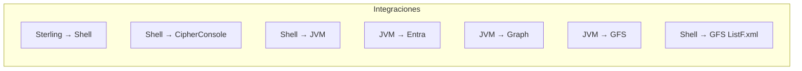

# C4 — Vista: integraciones y protocolos

Contratos entre contenedores (complementa el diagrama de contenedores).

← [Índice](README.md) · [02-contenedores.md](02-contenedores.md)

---

## Diagrama

---

## Matriz de integraciones

| # | Origen | Destino | Protocolo / contrato |
|---|--------|---------|----------------------|
| 1 | Sterling BP | `app.5.4.0.sh` | Args `"<correo>" "<WFID>"`; exit 0/1 |
| 2 | Shell | CipherConsole | `decrypt -n <nombre> -i *.enc -o *_out` |
| 3 | Shell | JAR | Classpath JAR + Netty `jars/4.1.118` |
| 4 | Client | Entra ID | OAuth 2.0 client credentials; scope `.default` |
| 5 | Mailbox | Graph | HTTPS JSON; `Mail.ReadWrite` (application) |
| 6 | Mailbox | GFS | `PATH + dominio/usuario/archivo` |
| 7 | Shell | GFS | `ListF.xml` con rutas adjuntos |

---

## Narrativa

- **Sterling ↔ shell:** mínimo contrato; Sterling no valida token Graph.
- **Shell ↔ Cipher:** acoplamiento a `/gfssterling/cipher/`.
- **Shell ↔ JAR:** solo el shell conoce `WFID` y arma `-dir`.
- **JAR ↔ Graph:** `users/{email}/...` con permiso de aplicación.
- **JAR ↔ GFS:** subcarpetas por remitente (`getSubfolderFromMailAddress`).

---

## Referencias

- Secuencia: [06-dinamica-e2e.md](06-dinamica-e2e.md)
- Seguridad: [08-seguridad-datos.md](08-seguridad-datos.md)
