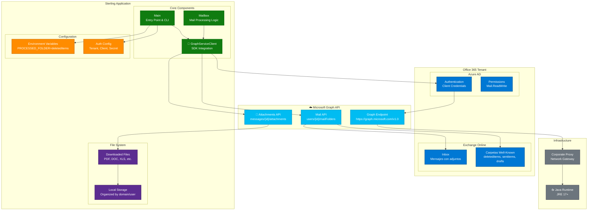
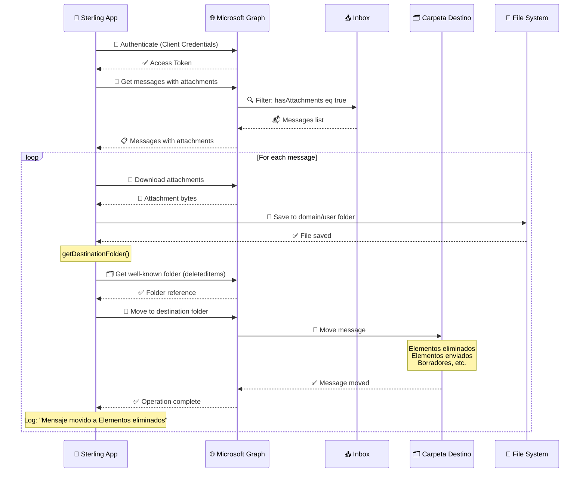

# Arquitectura - Sterling Microsoft Graph SDK

## 🏗️ Visión General

Aplicación Java para procesar adjuntos de correos de Office 365 usando Microsoft Graph API, con arquitectura simplificada que usa únicamente carpetas well-known.

### 📊 Análisis del Código
- **Archivos Java**: 5 archivos principales
- **Framework**: Java puro + Microsoft Graph SDK
- **Tipo**: Aplicación batch standalone

## 📊 Diagrama de Arquitectura



## 🔄 Flujo de Procesamiento Actualizado



## ✅ Características Clave Actualizadas

### 🎯 **Nomenclatura Clara**
- **Métodos descriptivos**: `getDestinationFolder()`, `moveMessageToDestinationFolder()`
- **Logging específico**: Muestra carpeta real (ej: "Elementos eliminados")
- **Variables claras**: `PROCESSED_FOLDER` configura carpeta destino

### 🗂️ **Scripts Organizados**
```
scripts/
├── build/          # compile.sh, check-hardcoded.sh
├── tests/          # test-*.sh, validate-solution.sh  
├── deployment/     # deploy.sh
├── verify-paths.sh # Verificador de rutas
└── fix-paths.sh   # Corrector automático
```

### 📊 **Logging Mejorado**
```bash
# Configuración
📁 Usando carpeta: Elementos eliminados

# Procesamiento  
📁 Obteniendo carpeta well-known: 'deleteditems' (Elementos eliminados)
✅ Carpeta 'deleteditems' obtenida: Deleted Items
📁 Mensaje movido a Elementos eliminados: Factura enero 2024
```

## 🚀 **Ventajas de la Arquitectura**
- ✅ **Confiable**: Usa infraestructura nativa de Office 365
- ✅ **Eficiente**: Sin overhead de creación/validación de carpetas
- ✅ **Mantenible**: Código simple y directo
- ✅ **Escalable**: Procesa cualquier volumen de mensajes
