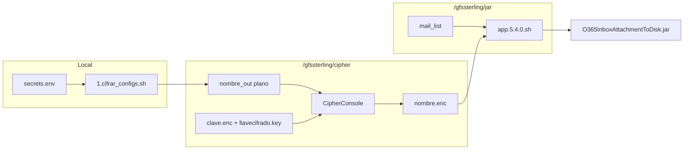

# Manual único — O365InboxAttachmentToDisk (despliegue y operación)

Versión del artefacto: ver `pom.xml` (actual **5.4.3**).  
Audiencia: desarrollo, operaciones Sterling, soporte MFT.

> **Documento canónico** de `docs/implementacion/`: despliegue GFS, Cipher, certificados, build, ejecución y troubleshooting.  
> Planificación: [00-BACKLOG-y-orden-implementacion.md](00-BACKLOG-y-orden-implementacion.md). Entregable: [artifact/README.md](../../artifact/README.md).

---

## 1. Propósito

Aplicación Java **batch** que:

1. Lee mensajes del **Inbox** con adjuntos (`hasAttachments eq true`).
2. Descarga adjuntos a GFS en rutas `dominio/remitente/archivo`.
3. Mueve cada mensaje a una carpeta **well-known** de Exchange (por defecto **Elementos eliminados** / `deleteditems`).

No crea carpetas personalizadas bajo Inbox (cambio v2.0 — ver [Histórico de cambios](../HISTORICO-CAMBIOS.md)).

---

## 2. Mapa de documentación (complementos a este manual)

| Documento | Contenido |
|-----------|-----------|
| **Este manual** | Despliegue, uso, Cipher, Sterling GFS (§5–11) |
| [00-BACKLOG-y-orden-implementacion.md](00-BACKLOG-y-orden-implementacion.md) | Checklist B-01… |
| [artifact/README.md](../../artifact/README.md) | Entregable desplegable |
| [docs/README.md](../README.md) | Índice maestro documentación |
| [Arquitectura C4](../arquitectura/README.md) | Diagramas y flujos |
| [API / CLI](../support/api.md) · [Swagger](../../openapi/README.md) | Referencia técnica Graph |
| [deploy-lab.sh](../../scripts/deploy/deploy-lab.sh) | Despliegue JAR + `app.conf` al lab |
| [DELETED_ITEMS_CONFIGURATION.md](../DELETED_ITEMS_CONFIGURATION.md) | `PROCESSED_FOLDER` |
| [HISTORICO-CAMBIOS.md](../HISTORICO-CAMBIOS.md) | v2.0 well-known |
| [troubleshooting.md](../support/troubleshooting.md) | Errores ampliados |

---

## 3. Estructura del proyecto

```
sterling-msgraph-sdk-java/
├── README.md
├── pom.xml                          # O365InboxAttachmentToDisk 5.4.3
├── secrets.env.example              # Plantilla (versionar)
├── secrets.env                      # Secretos reales (NO versionar)
├── build.sh                         # Build principal → target/*.jar
├── run-tests.sh                     # Suite shell
├── src/main/java/co/com/edtech/msgraph/   # Desarrollo (no se despliega tal cual)
│   ├── App.java · Client.java · Mailbox.java · Validator.java
├── artifact/                        # ★ ENTREGABLE de despliegue → GFS
│   ├── README.md                    # Índice entregable + checklist
│   └── jar/                         # Paridad /gfssterling/jar/
│       ├── app.conf · app.5.4.0.sh · mail_list
│       ├── 1.cifrar_configs.sh
│       └── certs/                   # account/ · microsoft/
├── scripts/ · postman/ · docs/
```

**Regla:** lo operativo que instala operaciones en el ambiente vive en **`artifact/`** (+ JAR compilado en `target/`). Ver [artifact/README.md](../../artifact/README.md).

### Rutas GFS (Colpatria lab — referencia)

| Ruta | Uso |
|------|-----|
| `/gfssterling/jar/5.0.0/` | JAR sombreado |
| `/gfssterling/jar/app.conf` | Config global |
| `/gfssterling/jar/app.5.4.0.sh` | Ejecución por buzón + WFID |
| `/gfssterling/jar/mail_list` | Índice buzón → archivo cifrado |
| `/gfssterling/jar/mail-attachment/<WFID>/` | Salida adjuntos + `ListF.xml` |
| `/gfssterling/jar/certs/` | Certificados (canónico; repo: `artifact/jar/certs/`) |
| `/gfssterling/cipher/` | CipherConsole, `*.enc`, llaves |

---

## 4. Azure AD — aplicación, permisos, secretos y certificados

### 4.1 Registrar la aplicación

1. [Azure Portal](https://portal.azure.com) → **Microsoft Entra ID** → **App registrations** → **New registration**.
2. Nombre: p. ej. `O365InboxAttachmentToDisk-Sterling`.
3. Supported account types: según política del tenant (normalmente single tenant).
4. Redirect URI: **no requerido** para client credentials (app-only).

Anotar en `secrets.env`:

- `TENANT_ID` — Directory (tenant) ID  
- `CLIENT_ID` — Application (client) ID  

### 4.2 Permisos de aplicación (Microsoft Graph)

| Permiso | Tipo | Motivo |
|---------|------|--------|
| `Mail.ReadWrite` | **Application** | Leer inbox, adjuntos y **mover** mensajes |

Pasos:

1. App → **API permissions** → **Add a permission** → **Microsoft Graph** → **Application permissions**.
2. Marcar **Mail.ReadWrite**.
3. **Grant admin consent** para el tenant.

Sin admin consent: errores **403 Insufficient privileges**.

Permisos delegados (usuario) **no** aplican al flujo batch con client credentials del JAR en GFS.

### 4.3 Acceso al buzón (app-only)

Con permisos de aplicación, el buzón `MAIL_CORREO` debe ser accesible por la app (política Exchange / Application Access Policy según el banco). Validar:

```bash
source scripts/load-secrets.sh
./postman/get-jwt.sh   # debe devolver JWT eyJ...
curl -s -H "Authorization: Bearer $(./postman/get-jwt.sh)" \
  "https://graph.microsoft.com/v1.0/users/${MAIL_CORREO}/mailFolders?\$top=1"
# HTTP 200
```

### 4.4 Client secret (desarrollo / Postman)

1. App → **Certificates & secrets** → **New client secret**.
2. Copiar valor a `secrets.env` → `CLIENT_SECRET` (solo se muestra una vez).
3. Rotar periódicamente; actualizar `secrets.env` y archivos cifrados GFS si aplica.

### 4.5 Certificado (producción GFS — recomendado)

**Carpeta única** (repo y GFS):

| Entorno | Ruta |
|---------|------|
| Repositorio | `artifact/jar/certs/` |
| GFS | `/gfssterling/jar/certs/` |

Estructura: `account/<alias>-full.pem` (Graph), `account/<alias>.crt` (subir a Entra), opcional `account/<cliente>/`, CAs en `microsoft/`. Detalle: [`artifact/jar/certs/README.md`](../../artifact/jar/certs/README.md).

1. Generar o importar certificado con clave privada (PEM/PFX según estándar del banco).
2. Colocar PEM operativo en `artifact/jar/certs/account/<alias>-full.pem` (desarrollo) o la misma ruta bajo `/gfssterling/jar/certs/` (lab/prod).
3. En Entra: **Certificates & secrets** → **Upload certificate** (`.crt` / clave pública).
4. `secrets.env`: `PRIVATE_CERTIFICATE=artifact/jar/certs/account/<alias>-full.pem` (ruta relativa al repo) o ruta absoluta en GFS.
5. Cipher / `1.cifrar_configs.sh`: `privateCertificate` y `certificatePassword` en el `.enc` del buzón.

El JAR acepta `-certificate` + `-certificatePassword` en lugar de `-secret` (`App.java`).

### 4.6 Proxy corporativo

En `secrets.env`:

```bash
PROXY_HOST=latam-proxy-SLV.glb.lnm.bns
PROXY_PORT=3128
```

El wrapper `app.5.4.0.sh` pasa `-host` y `-port` al JAR tras desencriptar config.

---

## 5. Configuración cifrada en GFS (CipherConsole)

Producción **no** guarda secretos en texto plano en `app.conf`. Flujo por buzón:



### 5.1 Archivo `mail_list`

Formato (una línea por buzón):

```text
correo@dominio.com=:nombre_base
```

Ejemplo en repo (`artifact/jar/mail_list`):

```text
sfg_domiciliacion@edtech.com.co=:sfg_domiciliacion
```

- Columna 1: correo que recibe Sterling como argumento del script.  
- Columna 2: nombre base del archivo cifrado `nombre_base.enc` en `/gfssterling/cipher/`.

### 5.2 Crear llave en Cipher (servidor)

En el servidor GFS (usuario con acceso a `/gfssterling/cipher`):

```bash
cd /gfssterling/cipher
sh SetupCipher.sh
# Opción 5 — crear llave
# Nombre: sfg_domiciliacion  (debe coincidir con -n en encrypt/decrypt)
```

Verificar:

```bash
cd /gfssterling/cipher
FileCipher=/gfssterling/cipher/clave.enc
KeyPrivate=/gfssterling/cipher/llavecifrado.key
./CipherConsole list --all --pwdfile "$FileCipher" --pwdkey "$KeyPrivate"
```

### 5.3 Generar archivo plano (estación de trabajo o servidor)

Desde la raíz del repo, con `secrets.env` completo:

```bash
source scripts/load-secrets.sh
./artifact/jar/1.cifrar_configs.sh
# Escribe /gfssterling/cipher/<nombre>_out en el path configurado en el script
# (ajustar si se ejecuta fuera del servidor: copiar el _out al cipher remoto)
```

Variables escritas en el plano:

- `client`, `tenant`, `privateCertificate`, `certificatePassword`, `proxy`, `proxyPort`

### 5.4 Cifrar con CipherConsole (servidor)

```bash
cd /gfssterling/cipher
File=sfg_domiciliacion
FileOut="${File}_out"
FileDec="${File}.enc"
KeyCipher="--pwdfile /gfssterling/cipher/clave.enc --pwdkey /gfssterling/cipher/llavecifrado.key"

./CipherConsole encrypt -i "$FileOut" -o "$FileDec" -f enc -n "$File" $KeyCipher
rm -f "$FileOut"    # no dejar plano en disco
ls -la "$FileDec"
```

### 5.5 Desencriptación en runtime (`app.5.4.0.sh`)

El script:

1. Carga `app.conf` (`FileJar`, `JARPATH`, `JAVA_HOME`, …).
2. Resuelve `nombre_base` desde `mail_list` según el correo argumento.
3. Ejecuta `CipherConsole decrypt` → exporta variables → invoca Java.
4. Escribe adjuntos en `/gfssterling/jar/mail-attachment/<WFID>/`.
5. Genera `ListF.xml` para Sterling.

---

## 6. Build y pruebas locales

```bash
cp secrets.env.example secrets.env   # completar valores
source scripts/load-secrets.sh
./build.sh                           # o ./scripts/build/compile.sh
mvn test                             # unit tests
```

Prueba rápida Graph con **client secret** (el JAR no lee `secrets.env` solo; hay que exportar y pasar flags):

```bash
mkdir -p ./tmp-attachments
export PROCESSED_FOLDER=deleteditems
java -jar target/O365InboxAttachmentToDisk-*.jar \
  -tenant "$TENANT_ID" -client "$CLIENT_ID" -secret "$CLIENT_SECRET" \
  -email "$MAIL_CORREO" -dir "./tmp-attachments/" \
  -host "$PROXY_HOST" -port "$PROXY_PORT"
```

Con **certificado** (ruta canónica `artifact/jar/certs/account/`):

```bash
java -jar target/O365InboxAttachmentToDisk-*.jar \
  -tenant "$TENANT_ID" -client "$CLIENT_ID" \
  -certificate "$PRIVATE_CERTIFICATE" \
  -certificatePassword "$CERTIFICATE_PASSWORD" \
  -email "$MAIL_CORREO" -dir "./tmp-attachments/"
```

Salida en disco: `dominio/remitente/archivo`. Postman:

```bash
./scripts/sync-postman-env.sh
# Importar postman/*.json
```

---

## 7. Despliegue en servidor Sterling

**Entregable:** sincronizar [`artifact/`](../../artifact/README.md) con `/gfssterling/jar/` y copiar el JAR desde `target/`. Checklist en `artifact/README.md`.

### 7.0 Sincronizar `artifact/jar/` → GFS

| Origen (repo) | Destino GFS |
|---------------|-------------|
| `artifact/jar/app.conf`, `app.5.4.0.sh`, `mail_list` | `/gfssterling/jar/` |
| `artifact/jar/certs/` | `/gfssterling/jar/certs/` |
| `target/O365InboxAttachmentToDisk-<ver>.jar` | `/gfssterling/jar/5.0.0/` |

No copiar `secrets.env` al servidor. Credenciales por buzón: `*.enc` en `/gfssterling/cipher/`.

```bash
export JASPER_SCP_BIN=/mnt/c/Windows/System32/OpenSSH/scp.exe
$JASPER_SCP_BIN -r artifact/jar/app.conf artifact/jar/app.5.4.0.sh artifact/jar/mail_list \
  sterling@192.168.137.190:/gfssterling/jar/
```

### 7.1 Prerrequisitos en `192.168.137.190` (lab)

- JRE 17: `/gfssterling/java/temurin-jre-17.0.13`
- JAR en `/gfssterling/jar/5.0.0/`
- `app.conf` con `FileJar="O365InboxAttachmentToDisk-5.4.3.jar"`

### 7.2 Copiar JAR (WSL2 → Hyper-V)

```bash
export JASPER_SSH_BIN=/mnt/c/Windows/System32/OpenSSH/ssh.exe
export JASPER_SCP_BIN=/mnt/c/Windows/System32/OpenSSH/scp.exe

./scripts/build/compile.sh
sha256sum target/O365InboxAttachmentToDisk-5.4.3.jar

$JASPER_SCP_BIN target/O365InboxAttachmentToDisk-5.4.3.jar \
  sterling@192.168.137.190:/gfssterling/jar/5.0.0/

$JASPER_SSH_BIN sterling@192.168.137.190 \
  "sha256sum /gfssterling/jar/5.0.0/O365InboxAttachmentToDisk-5.4.3.jar"
```

### 7.3 Ejecución operativa

```bash
$JASPER_SSH_BIN sterling@192.168.137.190 \
  'cd /gfssterling/jar && ./app.5.4.0.sh "sfg_domiciliacion@edtech.com.co" "WFID12345"'
```

Salida esperada:

- Logs: `Usando carpeta: Elementos eliminados`, `Mensaje movido a Elementos eliminados`.
- Archivos: `/gfssterling/jar/mail-attachment/WFID12345/...`
- `ListF.xml` con lista de rutas.

### 7.4 Smoke JAR en servidor

```bash
/gfssterling/java/temurin-jre-17.0.13/bin/java \
  -jar /gfssterling/jar/5.0.0/O365InboxAttachmentToDisk-5.4.3.jar
# Esperado: Missing parameters
```

---

## 8. Carpeta destino de mensajes (`PROCESSED_FOLDER`)

| Valor | Carpeta Exchange |
|-------|------------------|
| `deleteditems` (default) | Elementos eliminados |
| `sentitems` | Elementos enviados |
| `drafts` | Borradores |
| `junkemail` | Correo no deseado |

Solo esta variable la lee el JAR vía `System.getenv` en `Mailbox.java`. El resto de credenciales va por CLI o config cifrada.

Detalle: [DELETED_ITEMS_CONFIGURATION.md](../DELETED_ITEMS_CONFIGURATION.md).

---

## 9. Integración con Sterling

- Sterling invoca `app.5.4.0.sh` con **correo** y **WFID** (ID de flujo / carpeta de trabajo).
- El WFID define el subdirectorio bajo `mail-attachment/`.
- `ListF.xml` es la lista de ficheros para el BP posterior.

---

## 10. Troubleshooting

| Síntoma | Acción |
|---------|--------|
| `Missing parameters` | Pasar pares `-flag valor` al JAR |
| JAR exit 0 con error en log | Desde v5.4.3+ el JAR usa `System.exit(1)` si falla Graph/validación |
| 401/403 Graph | Admin consent, `Mail.ReadWrite` application, acceso al buzón |
| Correo no en `mail_list` | Añadir línea `correo=:nombre_base` |
| Fallo decrypt | Verificar `*.enc`, llave Cipher `-n`, `clave.enc` |
| Proxy timeout | `-host`/`-port` o variables en config cifrada |
| Carpeta inválida | Solo well-known; ver `PROCESSED_FOLDER` |

Más: [troubleshooting.md](../support/troubleshooting.md).

---

## 11. Checklist post-despliegue

- [ ] JAR en `/gfssterling/jar/5.0.0/` y SHA256 coincide con build
- [ ] `app.conf` → `FileJar` correcto
- [ ] `mail_list` actualizado
- [ ] `*.enc` y llave Cipher existentes
- [ ] Certificado en ruta `privateCertificate`
- [ ] `./postman/get-jwt.sh` → HTTP 200 en mailFolders (desde estación con red)
- [ ] `./app.5.4.0.sh "<buzón>" "TEST_WFID"` → exit 0 y `ListF.xml`

---

## 12. Referencias externas

- [Microsoft Graph mailFolders](https://learn.microsoft.com/en-us/graph/api/resources.mailfolder)
- [Client credentials flow](https://learn.microsoft.com/en-us/entra/identity-platform/v2-oauth2-client-creds-grant-flow)
- [Well-known folder names](https://learn.microsoft.com/en-us/graph/api/resources/mailfolder)
