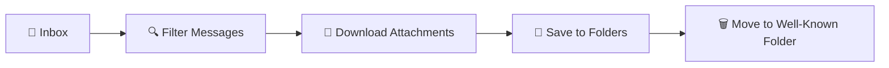

# 📚 Sterling Microsoft Graph SDK - Documentación

## 🎯 Descripción

Aplicación Java para procesar adjuntos de correos de Office 365 usando Microsoft Graph API. Descarga adjuntos organizadamente y mueve mensajes a carpetas well-known.

## 📋 Estructura de Documentación

### 🎨 [Diseño](design/)
- [📋 Requisitos del Sistema](design/requirements.md)
- [🏗️ Arquitectura](design/architecture.md)
- [🎯 Decisiones de Diseño](design/decisions.md)

### 🔨 [Build](build/)
- [🔨 Guía de Build](build/build-guide.md)
- [🛠️ Guía de Desarrollo](build/development.md)
- [📦 Instalación](build/installation.md)

### 🚀 [Implementación](implementation/)
- [🚀 Guía de Deployment](implementation/deployment-guide.md)
- [📖 Guía de Uso](implementation/usage.md)
- [🗑️ Configuración de Carpetas](DELETED_ITEMS_CONFIGURATION.md)

### 🆘 [Soporte](support/)
- [🚨 Troubleshooting](support/troubleshooting.md)
- [📚 Referencia de API](support/api.md)
- [🧪 Postman Collection](support/postman.md)

## 🚀 Inicio Rápido

### 1. Configuración
```bash
# Configurar variables de entorno
export TENANT_ID="your-tenant-id"
export CLIENT_ID="your-client-id"
export CLIENT_SECRET="your-client-secret"
export MAIL_CORREO="mailbox@domain.com"
export PATH_DESTINATION="/data/attachments"
export PROCESSED_FOLDER="deleteditems"
```

### 2. Build
```bash
./compile.sh
```

### 3. Ejecución
```bash
java -jar target/O365InboxAttachmentToDisk-*.jar
```

## ✅ Características Principales

- ✅ **Simplicidad**: Solo usa carpetas well-known de Office 365
- ✅ **Seguridad**: Client Credentials Flow con Azure AD
- ✅ **Organización**: Archivos organizados por dominio/usuario
- ✅ **Confiabilidad**: Sin creación de carpetas personalizadas
- ✅ **Proxy Support**: Compatible con redes corporativas

## 🏗️ Arquitectura Simplificada



## 📊 Métricas del Proyecto

- **Líneas de código**: ~120 (70% reducción)
- **Dependencias**: Microsoft Graph SDK + Azure Identity
- **Tiempo de startup**: < 5 segundos
- **Memoria**: < 512MB heap
- **Compatibilidad**: Java 17+, todos los SO

## 🔗 Enlaces Útiles

- [Microsoft Graph Documentation](https://docs.microsoft.com/en-us/graph/)
- [Azure AD App Registration](https://portal.azure.com/#blade/Microsoft_AAD_RegisteredApps)
- [Office 365 Admin Center](https://admin.microsoft.com/)

## 📞 Soporte

Para soporte técnico, consultar:
1. [Troubleshooting Guide](support/troubleshooting.md)
2. [API Reference](support/api.md)
3. Logs de aplicación
4. Equipo de desarrollo
